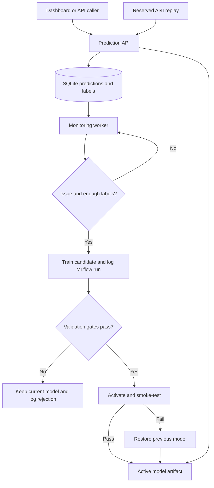

# MaintAI

**A local predictive-maintenance application with an auditable model recovery loop.**

Start with [START_HERE.md](START_HERE.md). The application runs on Python 3.12,
uses CPU models, and includes a Streamlit dashboard, FastAPI service, background
worker, MLflow experiment tracking, a local model registry, and a replay lab.

## What this version does

- Predicts the binary machine-failure target from six sensor/product inputs.
- Shows SHAP contributions for individual predictions.
- Produces exploratory, multi-label scores for the five AI4I failure types.
- Offers rule-based maintenance inspection suggestions and a clearly labelled heuristic health indicator.
- Replays reserved dataset records and reveals their true labels after a delay.
- Detects sustained covariate drift or a drop in labelled failure recall.
- Retrains only when sufficient new labels and class coverage are available.
- Compares candidates with the deployed model on fixed validation data and a fresh recent holdout.
- Promotes passing candidates, rejects others, and records every decision.
- Reloads the new artifact after activation and restores the predecessor if the smoke check fails.
- Automatically restores a valid predecessor when the active model becomes corrupt or unloadable.
- Restarts exited service processes through the local launcher (up to three attempts).

This is an end-to-end local engineering prototype. It does not guarantee recovery
from arbitrary faults or that retraining always improves quality.

## Architecture



The replay path scores batches through the same model implementation as the API,
but uses batch inference for speed. Labels are hidden from the predictor and
retained in the local demo store until their scheduled arrival.

### Components

| File | Responsibility |
|---|---|
| `maintai/data.py` | Original CSV ingestion, deterministic splits, integrity manifests, feature allowlist |
| `maintai/model.py` | Random forests, scoring, SHAP, artifact checks, MLflow logging |
| `maintai/store.py` | Transactional SQLite state, audit events, atomic model activation |
| `maintai/pipeline.py` | Replay, labels, monitoring, training gates, rollback, worker |
| `maintai/api.py` | Validated REST endpoints |
| `maintai/dashboard.py` | Local dashboard and recovery lab |
| `run_local.py` | Bootstrap and local process supervision |
| `tests/test_pipeline.py` | Leakage checks, integration tests and fault injection |

## Data and modelling choices

AI4I 2020 is a **synthetic** maintenance benchmark, not a live factory feed.
The unmodified UCI CSV is bundled with attribution in `data/NOTICE.md`.

| Partition | Records | Purpose |
|---|---:|---|
| Training | 6,000 | Baseline fitting |
| Validation | 1,500 | Fixed candidate/champion comparison |
| Replay | 1,500 | Simulated incoming readings and delayed outcomes |
| Final test | 1,000 | Optional final evaluation, never used for promotion |

Splits are stratified with seed 42. This is a static benchmark split, not a
claim of chronological or machine-independent validation. The dataset does not
provide a real deployment's asset histories and delayed event lifecycle.
Each split has a SHA-256 fingerprint in `runtime/data/manifest.json`.

Input features are product type, air temperature, process temperature,
rotational speed, torque, and tool wear. Derived features are temperature gap,
mechanical power, and the wear–torque product. Product ID, UDI/source ID,
machine failure, and all five failure flags are excluded from predictors.

The baseline is a class-weighted random forest. Threshold is fixed at 0.35.
The score is not calibrated as a real-world failure probability. SHAP explains
the model output; it does not establish physical causation. Failure types may
overlap, so their scores are multi-label rather than mutually exclusive.
The primary recovery gates evaluate the binary failure model; auxiliary
failure-type outputs are exploratory and require dedicated validation before
operational use. Random failures in particular may be inherently unpredictable.

The displayed health indicator is `100 × (1 − failure score)`. It is not a
measured health percentage or remaining-useful-life estimate. Recommendations
are inspection rules, not optimized maintenance schedules or automatic machine controls.

## Monitoring and retraining policy

- Observe the latest 500 readings; require at least 100.
- Numeric drift uses a two-sample KS test, minimum statistic 0.15, and a
  Bonferroni-adjusted significance level of 0.01 across five numeric features.
- Product-type drift uses total-variation distance of at least 0.15.
- Require two changed windows, with at least 100 new readings between updates.
  The windows can overlap; this is a debounce rule, not independent statistical confirmation.
- Compare current-model recall against its validation recall after at least
  100 labelled recent predictions and at least five outcomes from each class.
  A drop below `max(0.5, baseline_recall − 0.10)` can also trigger evaluation.
- Require at least 300 unused labelled readings and 12 examples from each class.
- Hold back 35% of new labelled rows for recent evaluation. Permanently reserve
  their role before training so a process crash cannot leak them into future fitting.
- Apply a 600-second cooldown between training attempts.

### Promotion gates

| Check | Required value |
|---|---|
| Fixed validation recall | At least 0.65 |
| Fixed validation precision | At least 0.30 |
| Fixed validation recall regression | At most 0.03 |
| Fixed validation average-precision regression | At most 0.02 |
| Recent holdout recall | At least 0.65 |
| Recent holdout precision | At least 0.30 |
| Recent holdout recall regression | At most 0.03 |
| Recent holdout average-precision improvement | At least 0.002 |

These are transparent demonstration thresholds, not statistically validated
industrial acceptance criteria. A later deployment should use sufficient
failure counts, confidence intervals, business costs and a monitored probation
period. Repeated decisions against a fixed validation set can overfit it; the
final test split must remain out of model selection.

Retraining uses the original training split plus eligible new training rows.
The worker never trains on its own predicted labels. Manual outcome feedback
can be supplied through `/feedback/{prediction_id}`. User-submitted labels are
trusted local inputs; real deployment will need authenticated provenance.

## Persistence and recovery boundaries

`runtime/` stores SQLite state, MLflow SQLite tracking, immutable model artifacts,
dataset partitions, comparison reports, and service logs. Model activation is
a transaction in SQLite. File locking prevents two workers from retraining or
replaying concurrently. Model artifacts are checked against registered hashes.
Pickle/joblib artifacts must be trusted: there is deliberately no model-upload endpoint.

The API resolves the active version for each request; in-flight requests may
complete with the previous version. The local launcher restarts exited processes,
not hung processes. Docker's restart policy also restarts exited containers;
an unhealthy health check alone does not restart a container. The model worker
checks artifact integrity, but a stopped worker cannot repair itself unless its
supervisor is running. Host failure, a full disk, damaged SQLite files, and loss
of both model versions require separate operational recovery.

Training roles are reserved before fitting. If training crashes, those records
stay reserved and the current model remains active. There is no automatic job
resume for that interrupted attempt. Subsequent eligible data can trigger a new
attempt, including the accumulated training-role rows.

MLflow logs parameters, metrics, data hashes, training source IDs and model
artifacts. If MLflow fails, the local registry and audit trail remain usable and
the failure is explicitly logged. The local SQLite registry controls activation;
this version does not use MLflow Registry aliases.

The original proposal included DVC and Evidently. This first version uses
checksum manifests for dataset snapshots and an explicit SciPy drift monitor.
It does not claim to have DVC or Evidently integrations. They can be introduced
behind the data and monitoring interfaces later.

## Commands

Run from the project folder with the virtual environment's Python:

```bash
python run_local.py
python -m maintai status
python -m maintai replay --count 250 --scenario high-wear
python -m maintai tick
python -m maintai rollback
python -m maintai evaluate-test
python -m pytest -q
```

`evaluate-test` is for final reporting, not threshold tuning. The implementation
does not prevent repeated use; keep it out of iterative model selection.

The complete MLflow UI is optional. The default `mlflow-skinny` package supplies
tracking APIs. If you want its web UI, install the matching full `mlflow==3.1.4`
package in the same environment, then start it with the tracking database under
your runtime folder. The MaintAI Model history tab works without that UI.

### Environment variables

| Variable | Default | Purpose |
|---|---|---|
| `MAINTAI_HOME` | `runtime` | All mutable local state |
| `MAINTAI_WORKER_SECONDS` | `15` | Worker poll interval |
| `MAINTAI_LABEL_DELAY_SECONDS` | `30` | Demo outcome delay |
| `MAINTAI_COOLDOWN_SECONDS` | `600` | Minimum interval between training attempts |
| `MAINTAI_API_URL` | `http://127.0.0.1:8000` | Dashboard API URL |
| `MAINTAI_DEMO_ENABLED` | `true` | Enable/disable replay endpoints |

## Later AWS migration

First run the same Docker image on EC2 with persistent storage and a backup
policy. Move artifacts and data snapshots to S3 through a storage adapter;
the current filesystem implementation does not yet write to S3. Use an EC2 IAM
role instead of embedding credentials. Add authentication, TLS, controlled
network access, cost budgets, remote logs and alarms before exposing the app.

For a multi-instance setup, replace local SQLite and file locking with a shared
database and durable job coordination. Add health-based service replacement,
deployment probation, backups and restore drills. Docker portability reduces
packaging changes, but does not implement these cloud operations automatically.

The local API intentionally has no authentication and binds to localhost.
The supplied Compose ports are also restricted to localhost. Do not expose
these endpoints publicly without implementing access controls.

## References

- [UCI AI4I 2020 dataset](https://archive.ics.uci.edu/dataset/601/ai4i+2020+predictive+maintenance+dataset)
- [RandomForestClassifier](https://scikit-learn.org/1.8/modules/generated/sklearn.ensemble.RandomForestClassifier.html)
- [SHAP TreeExplainer](https://shap.readthedocs.io/en/latest/generated/shap.TreeExplainer.html)
- [MLflow tracking](https://mlflow.org/docs/latest/ml/tracking/)
- [FastAPI testing](https://fastapi.tiangolo.com/tutorial/testing/)
